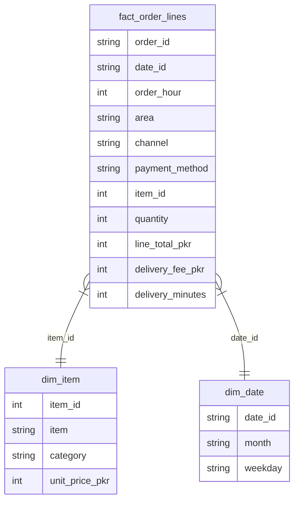

# P10 — Food-Delivery Sales Analysis: restaurant orders → Power BI dashboard + best-sellers report

**Restaurant:** Lahore Food Co (fictional) · **Period:** Jul–Sep 2026 (Q3) · **Status: SAMPLE delivery on DEMO data**
**Tools:** Power BI (DAX) · SQL star schema (SQLite) · Python (pandas + reportlab)
**Model:** `data/model.db` + `data/processed/*.csv` (Power BI-ready) · **Measures:** `dax/measures.dax`
**Build guide:** `dashboard/powerbi-build-guide.md` (import → relationships → measures → visuals, ~15 min)
**Deliverable:** `outputs/best_sellers_report_SAMPLE.pdf` (2 pages: top-10 sellers, category table, peak hours, delivery read, 5 actions)

> ⚠️ **Demo data only.** Every number here comes from a seeded generator
> (`src/build_model.py`, seed 10) for a fictional Lahore restaurant. It
> is **not** real order data and no real restaurant is named. The model,
> the DAX, the dashboard design and the report are real; the client
> history is not claimed.

> **Honest note on the .pbix file:** no `.pbix` is bundled with this repo.
> Power BI Desktop (Windows) is required to author a real `.pbix`, and
> faking one would be dishonest. Instead this repo ships everything a
> real build needs — a clean star-schema model, the DAX measures, and a
> step-by-step build guide — plus preview renders of the same data
> (`dashboard/previews/`, made with matplotlib and labelled as renders,
> **not** Power BI screenshots). A buyer on a real order gets the finished
> `.pbix` built in Power BI Desktop from this exact model, and the
> best-sellers report rebuilt from their own order export.

## Business question it answers

> "Which dishes actually make us money, when do orders peak, and where
> is delivery losing us repeat customers?"

A sales total alone hides the story. This delivery answers it with a
Power BI dashboard (KPIs, monthly trend, category and top-item views,
orders-by-hour, slicers by channel and area) plus a 2-page best-sellers
report a restaurant owner can act on without opening Power BI.

## What is inside

| File | What it does |
|---|---|
| `outputs/best_sellers_report_SAMPLE.pdf` | The deliverable: top-10 sellers, category table, peak hours, delivery read, 5 actions |
| `data/model.db` | SQLite star schema: `fact_order_lines` + `dim_item` / `dim_date` |
| `data/processed/*.csv` | The same model as CSVs — import these directly into Power BI |
| `data/raw/orders_SAMPLE.csv` | 3,296 order lines / 1,800 orders, untouched — the "before" |
| `sql/schema.sql` | The star-schema DDL (also loads into PostgreSQL with no changes except types) |
| `dax/measures.dax` | Copy-paste DAX: Total Food Sales, Total Delivery Fees, Total Revenue, Orders, AOV, Average Delivery Minutes, Slow Orders %, Top Item Sales, MoM growth |
| `dashboard/powerbi-build-guide.md` | Relationships, measures, and the exact visual layout, step by step |
| `dashboard/previews/*.png` | Preview renders of the trend, category, top-10 and hourly charts (matplotlib, labelled) |
| `outputs/insights.md` | Findings + 3 recommendations in plain English |
| `src/build_model.py` | Seeded generator + loader: re-run for identical numbers |
| `src/build_report.py` | Recomputes every KPI from the CSV and builds the PDF + charts |
| `src/checks.py` | Data-quality checks as code — 25 checks, all passing |

## Model (star schema)

One row per order line; delivery fee and delivery minutes are
order-level facts repeated on each line of the order, so order-level
totals must use `DISTINCT order_id`, never a plain `SUM` over lines.

## 3 key findings (from the demo data)

1. **Karahi is the profit engine, Biryani is the volume engine.**
   Chicken Karahi (half) is the top seller by money — PKR 195,500
   from only 169 orders — while Chicken Biryani leads on reach
   (281 orders, PKR 134,050). *So what:* Karahi earns the menu's top
   slot and Biryani earns the "most ordered" badge.
2. **Two peaks carry two-thirds of the business.** Lunch 13:00–15:00
   (550 orders, 30.6%) and dinner 19:00–22:00 (595 orders, 33.1%)
   together are 63.6% of orders. *So what:* rider and kitchen staffing
   is a peak-hours problem, not an all-day problem.
3. **Delivery is the weak link, and it is geographic.** Average
   delivery 32.6 minutes, but 151 orders (8.4%) took over 45 minutes;
   Johar Town averages 39.3 minutes against Gulberg's 26.8.
   *So what:* fix rider allocation in Johar Town before spending on
   ads there.

## Verified KPIs

| KPI | Value |
|---|---|
| Total revenue | PKR 1,712,880 |
| Food sales | PKR 1,591,120 |
| Delivery fees | PKR 121,760 |
| Orders | 1,800 |
| Order lines | 3,296 |
| Average order value (food) | PKR 884 |
| Best category | BBQ & Grill (PKR 389,280) |
| Best seller | Chicken Karahi, half (PKR 195,500) |
| Best month | August 2026 (PKR 569,970) |
| Top channel | App (1,041 orders, 57.8%) |
| Average delivery | 32.6 min |
| Average rating | 4.31 / 5 (1,268 rated orders) |

Verification: `python3 src/checks.py` — 25 checks pass, including
fact total = raw CSV total (1,591,120), every `line_total` =
quantity × price, the delivery-fee rule (PKR 0 iff food ≥ 1,500),
and the SQLite model agreeing with the CSV row for row. The PDF was
reopened and read back: 2 pages, top-10 table + category table +
charts + 5 actions all present.

## Limits

- **Sample data only.** One fictional restaurant, one quarter
  (Jul–Sep 2026), 6 Lahore areas, 3 channels, 24 menu items. No
  customer-level data, no real prices, no real restaurant.
- **No `.pbix` bundled.** Power BI Desktop (Windows) is required to
  author the finished dashboard from the model + DAX + build guide
  (see the honest note at the top).
- **The delivery-fee rule is the sample's rule** (PKR 80 per order,
  free when food ≥ PKR 1,500). A real restaurant's fee rule will
  differ — change it in `src/build_model.py` and re-run.
- **Ratings are partial:** only 1,268 of 1,800 orders (70%) carry a
  rating; the 4.31 average is over rated orders only.
- **Three months, no seasonality claim.** August is the best month
  of this quarter; nothing here proves a yearly pattern.

## How to run it (under 5 steps)

1. Open `outputs/best_sellers_report_SAMPLE.pdf` — that is the
   deliverable.
2. Or open `dashboard/powerbi-build-guide.md` and follow it in Power
   BI Desktop (import the 3 CSVs in `data/processed/`, paste the DAX).
3. To rebuild from scratch: `pip install -r requirements.txt`, then
   `python3 src/build_model.py`, `python3 src/build_report.py` and
   `python3 src/checks.py`.
4. To reuse it for a real restaurant: replace `data/raw/` with real
   order lines in the same columns — the schema, DAX and layout
   already fit; only the menu/area lists change.
5. Read `outputs/insights.md` before presenting it: findings first,
   then the dashboard.

## Tools

- Power BI Desktop (for the finished `.pbix` on a real order)
- Python 3 + pandas + matplotlib + reportlab (build scripts, renders and report only)
- SQLite (the model database; PostgreSQL-ready schema)

## Data source note

**Demo/sample data, generated for this project** (seeded generator,
seed 10: 1,800 orders, Jul–Sep 2026, 24 menu items across 6
categories, 6 Lahore areas, 3 channels). Prices are realistic PKR
menu ranges, not real prices. No customer names or payment details
exist in this data — by design.

## Repo standard note

This paid project follows the portfolio repo standard (Master Plan
§3.2), slimmed for a BI deliverable: README + data dictionary
(`data/README.md`) + the deliverable model + DAX + build guide +
preview renders + insights + best-sellers report + a Fiverr-ready
package note (`PACKAGE-NOTE.md`) + reproducible scripts. The `.pbix`
is honestly absent (see the note at the top) and is built in Power BI
Desktop on a real order.
